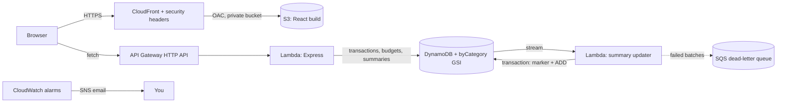

# Expense Tracker on AWS (Serverless)

## Features

- **Transactions:** add, edit (including moving a transaction to another month), delete, search, and filter by category.
- **Monthly budgets:** per-category limits with progress bars that turn amber at 80% and red when over.
- **Insights:** savings rate, spending versus last month, and the biggest category.
- **Charts:** spending by category and the last six months of income versus expenses.
- **CSV import and export:** import up to 200 rows at a time. Validation is all-or-nothing and names the bad row. Exports guard against spreadsheet formula injection.
- **Operations:** email alarms, a dead-letter queue, structured logs, 30-day log retention, and CI on every push.
- **Security:** private S3 bucket behind CloudFront, HTTPS-only with a strict CSP and security headers, least-privilege IAM, throttled API.

## Architecture



## Data model

One table, four kinds of item under the partition key `userId`:

| Item | Sort key `sk` | Purpose |
|---|---|---|
| Transaction | `2026-10-26#<expenseId>` | Any date range is one `Query`: `sk BETWEEN "2026-10-01" AND "2026-10-31~"` |
| Monthly total | `SUMMARY#2026-10` | `income`, `expense`, and a `cat#<Category>` number per category |
| Budget | `BUDGET#Food` | The monthly limit for a category |
| Dedupe marker | `EVT#<streamEventId>` | Makes the stream Lambda safe to retry; expires through TTL after a day |

- **GSI `byCategory`** (`userId` + `categoryDate`, e.g. `Food#2026-10-26`) lists one category for any date range.
- **Summaries are one `GetItem`**, and the bar chart is one `Query` on `begins_with(sk, "SUMMARY#")`. Nothing scans.
- **Editing** a transaction that changes its date is a delete and a put in one `TransactWriteItems`, so it can never be left missing or duplicated.

### How the totals stay correct

The API never writes summaries. A second Lambda reads the table's stream (`NEW_AND_OLD_IMAGES`) and applies an atomic `ADD`: plus on insert, minus on remove, both on modify.

- **Exactly-once effect.** Streams deliver at least once. Each stream record's `eventID` is written as an `EVT#` marker in the same transaction as the summary update, with `attribute_not_exists(sk)`. A retry finds the marker and changes nothing.
- **No feedback loop.** Only items whose sort key starts with a date count. Summary, budget and marker writes are ignored.
- **Poison records cannot block the shard.** `MaximumRetryAttempts: 2`, `BisectBatchOnFunctionError`, and failed batches go to an SQS dead-letter queue.
- **Eventually consistent.** Totals lag a write by about a second, so the UI refreshes them immediately and again 1.5 s later.

## API

| Method and path | What it does |
|---|---|
| `POST /expenses` | Add a transaction |
| `GET /expenses?month=2026-10` or `?from=&to=` | List by month or date range; add `&category=Food` to use the GSI |
| `PUT /expenses/:date/:expenseId` | Edit (the date in the URL is the current date) |
| `DELETE /expenses/:date/:expenseId` | Delete |
| `POST /expenses/import` | Import up to 200 rows, all-or-nothing |
| `GET /summary?month=` and `GET /summary/months` | Pre-computed totals |
| `GET /budgets`, `PUT /budgets/:category`, `DELETE /budgets/:category` | Monthly budgets |
| `GET /categories` | Valid categories per type |

## Run locally (PowerShell)

No AWS needed: with `TABLE_NAME` unset the API uses an in-memory store and applies summaries inline, because there is no stream locally.

```powershell
# terminal 1
cd backend; npm install; npm test; npm run dev     # http://localhost:3001

# terminal 2
cd frontend; npm install; npm test; npm run dev    # http://localhost:5173
```

Try the demo data: click **Import CSV** and pick `sample-data\expenses.csv` (36 rows over three months), then set a budget.

## Deploy (PowerShell)

```powershell
sam build
sam deploy --guided        # stack name expense-tracker-day02, region ap-south-1
powershell -ExecutionPolicy Bypass -File .\scripts\deploy-frontend.ps1
```

To get alarm emails, deploy with an address and confirm the SNS subscription email:

```powershell
sam deploy --parameter-overrides AlertEmail=you@example.com
```

Resources are tagged `project=day02` for Cost Explorer.

## Tear down

```powershell
aws s3 rm s3://<SiteBucketName> --recursive   # the bucket must be empty first
sam delete
```

## IAM: least privilege

| Lambda | Allowed |
|---|---|
| API | `Query`, `GetItem`, `PutItem`, `DeleteItem`, `BatchWriteItem` on the table and the `byCategory` index |
| Summary updater | `PutItem` and `UpdateItem` on the table, `SendMessage` on its dead-letter queue, plus stream read added by SAM |

Only the updater can modify summaries.

## CI

`.github/workflows/ci.yml` runs on every push and pull request: backend tests, frontend tests and build, and `cfn-lint` on the template. It uses no AWS credentials. Automated deploys with OIDC come on Day 14.

## Possible next steps

Day 3 adds Cognito, replacing the fixed `userId` with the token's `sub` claim. Recurring transactions through an EventBridge schedule fit naturally after that.
